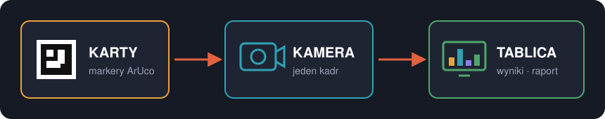
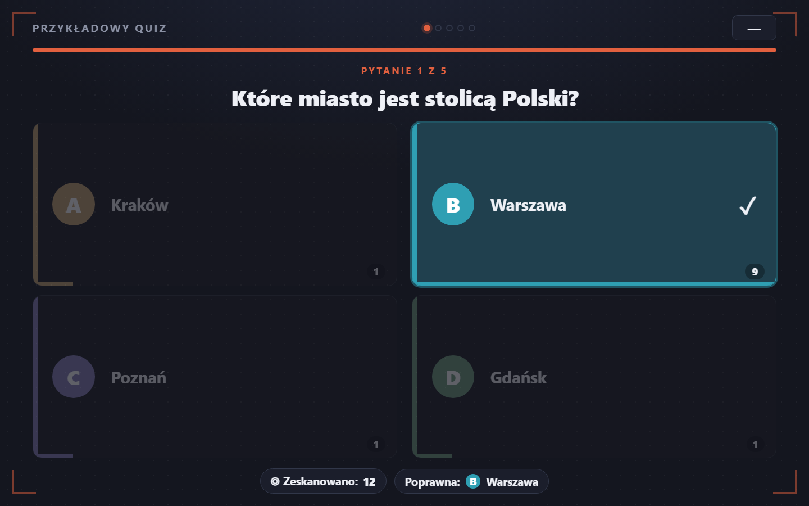
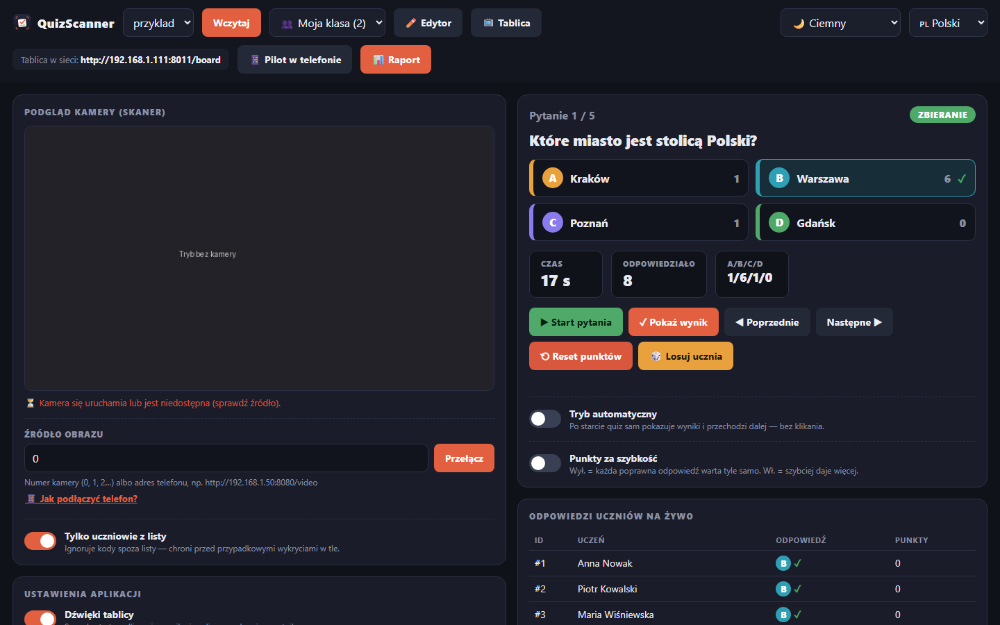
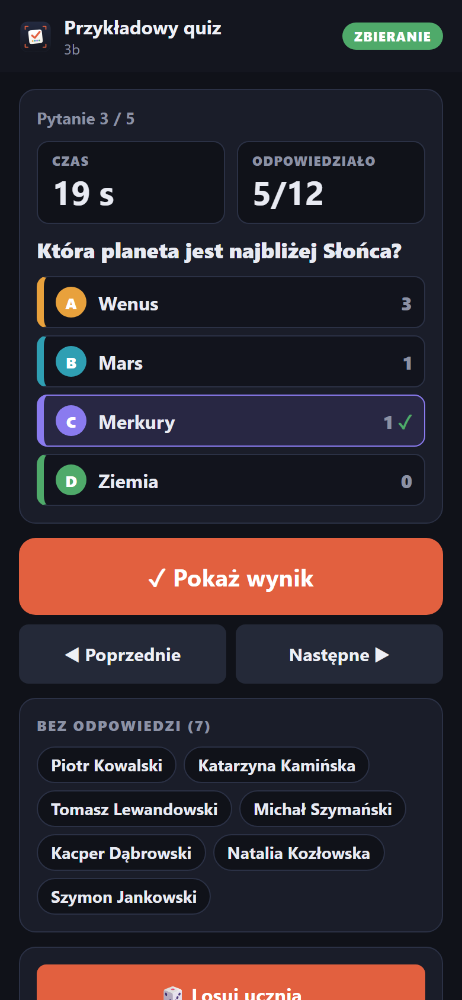
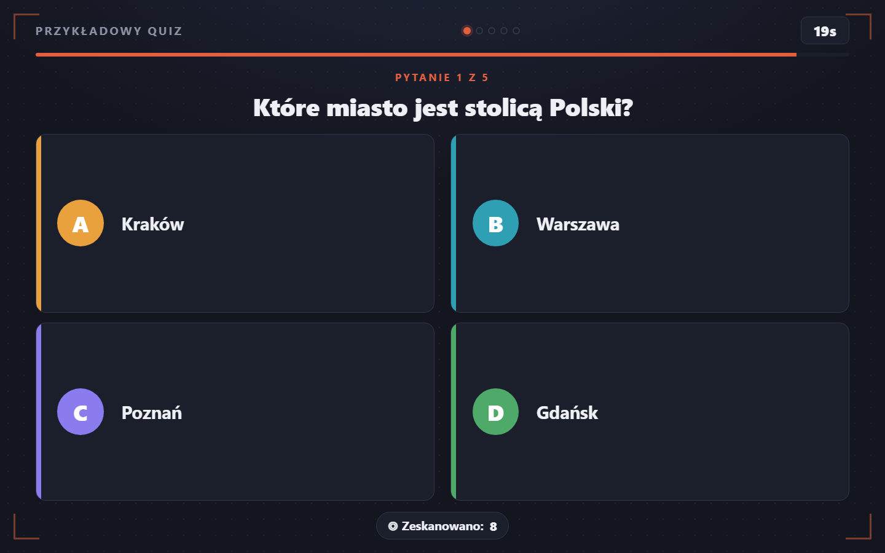
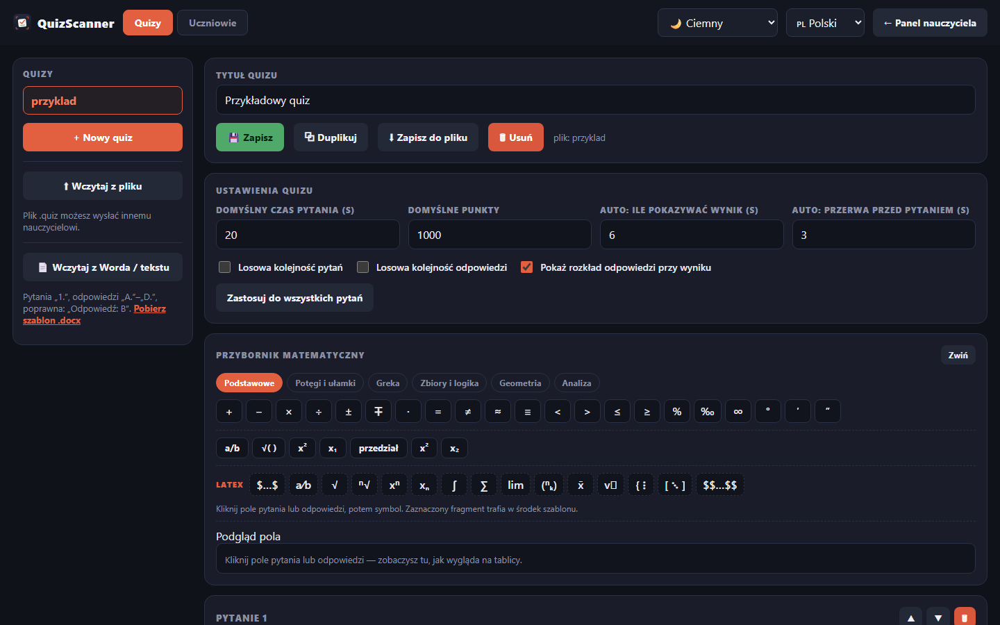
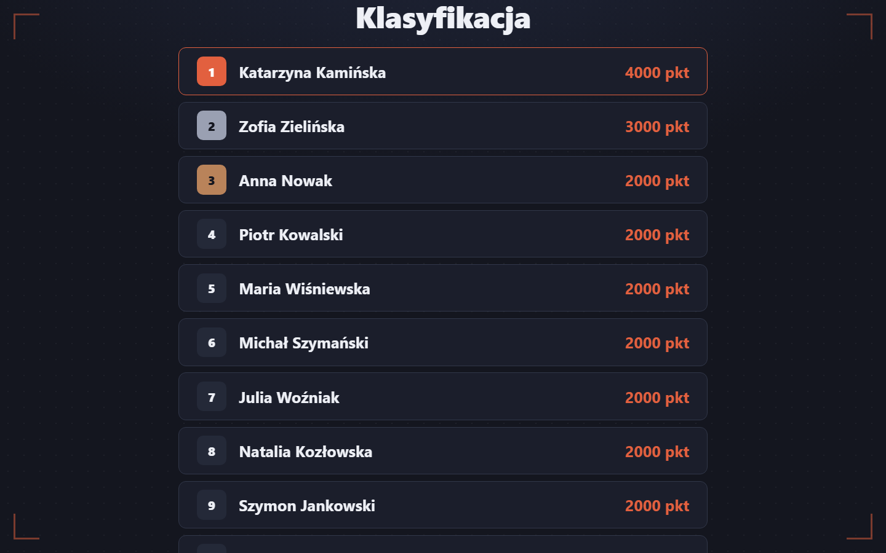

<p align="center">
  
</p>

<h1 align="center">QuizScanner</h1>

<p align="center">
  <b>Darmowy system quizowy z odczytem odpowiedzi z kamery.</b><br>
  Uczniowie podnoszą wydrukowane karty z markerami ArUco, a kamera odczytuje
  całą klasę w jednym kadrze — otwarta alternatywa dla Plickers.<br>
  <sub>Bez kont, bez limitów, bez chmury. Zero telefonów po stronie uczniów.</sub>
</p>

<p align="center">
  
  
  
  
  
  
  
</p>

<p align="center">
  <a href="#-instalacja"><b>Instalacja</b></a> ·
  <a href="docs/INSTALACJA.md">Instrukcja krok po kroku</a> ·
  <a href="docs/FAQ.md"><b>FAQ</b></a> ·
  <a href="CHANGELOG.md">Zmiany</a> ·
  <a href="https://github.com/PiotrKajor/QuizScanner/releases">Pobierz .exe</a>
</p>

---

## 🎯 W trzech zdaniach

Drukujesz jedną kartę na ucznia. Na pytanie uczeń obraca kartę wybraną literą
do góry, a kamera w jednym kadrze odczytuje odpowiedzi całej klasy. Ty widzisz
wyniki na żywo, klasa widzi tablicę na rzutniku, a po lekcji masz gotowy raport.

<p align="center">
  
</p>

## 📸 Jak to wygląda

<p align="center">
  
  <br><sub><b>Tablica na rzutniku</b> — wynik pytania z rozkładem odpowiedzi klasy</sub>
</p>

<table>
  <tr>
    <td width="66%"></td>
    <td rowspan="2" width="34%"></td>
  </tr>
  <tr>
    <td></td>
  </tr>
  <tr>
    <td align="center"><sub><b>Panel nauczyciela</b> (u góry) — odpowiedzi na żywo, sterowanie, losowanie ucznia;<br><b>tablica w trakcie pytania</b> (u dołu) — odliczanie czasu</sub></td>
    <td align="center"><sub><b>Pilot w telefonie</b> — kto jeszcze nie podniósł karty</sub></td>
  </tr>
  <tr>
    <td width="50%"></td>
    <td width="50%"></td>
  </tr>
  <tr>
    <td align="center"><sub><b>Edytor</b> — przybornik matematyczny i LaTeX, import z Worda</sub></td>
    <td align="center"><sub><b>Klasyfikacja</b> na koniec gry</sub></td>
  </tr>
</table>

Zrzuty odtwarza `python tools/screenshots.py` (symulowana lekcja, bez kamery).

## ✨ Funkcje

| | |
|---|---|
| 📷 **Odczyt z kamery** | jeden kadr wykrywa całą klasę naraz (markery ArUco) |
| 📱 **Pilot w telefonie** | parowanie kodem QR, sterowanie i lista „kto jeszcze nie odpowiedział" — bez instalowania aplikacji |
| 🔒 **Sterowanie tylko dla nauczyciela** | uczniowie w tej samej sieci widzą tablicę, ale nie przełączą pytania ani nie podejrzą odpowiedzi |
| 👥 **Klasy** | osobna lista dla każdej klasy, import z CSV/Excela (eksport z dziennika) |
| 📄 **Import z Worda** | test napisany w .docx lub .txt staje się quizem — szablon w edytorze |
| 🎲 **Losowanie ucznia** | animacja na tablicy, bez powtórzeń, opcjonalnie czytane na głos (offline) |
| 💾 **Wznowienie gry** | po zamknięciu programu w trakcie lekcji wracasz do tego samego pytania |
| 📱 **Telefon zamiast kamery** | darmowa aplikacja streamująca: IP Webcam, DroidCam, Iriun |
| ▶️ **Tryb automatyczny** | quiz sam odsłania wyniki i przechodzi dalej, bez klikania |
| 🖥️ **Tablica na rzutnik** | pytanie, timer, rozkład odpowiedzi, podium, powiększanie tekstu 80–175% |
| 🎨 **7 motywów** | ciemny (domyślny), jasny, ocean, las, zachód słońca, cukierkowy, wysoki kontrast |
| 🔊 **Dźwięki tablicy** | start, odliczanie, koniec czasu, wynik, fanfara — syntezowane, bez plików |
| 🧮 **Przybornik matematyczny** | symbole Unicode (√ π ≤ ∑ ∫) i pełny **LaTeX renderowany przez KaTeX** |
| 🖼️ **Zdjęcia i filmy w pytaniach** | JPG/PNG/GIF/WEBP, MP4/WEBM do 40 MB |
| 📊 **Raport po grze** | PDF, Excel, CSV, HTML, JSON, TXT + automatyczny zapis |
| ⬆️ **Automatyczna aktualizacja** | pasek z nową wersją i podmiana pliku jednym kliknięciem |
| ✏️ **Edytor z ustawieniami** | czas, punkty, losowanie pytań i odpowiedzi, opóźnienia trybu auto |
| 📤 **Quiz jako plik** | `.quiz` z osadzonymi mediami — jeden plik do wysłania koleżance z pracy |
| 🌍 **Polski i angielski** | przełącznik wspólny dla panelu, edytora i tablicy |
| 🎯 **Odporność na fałszywe odczyty** | ignoruje kody spoza listy klasy i wzory bez czarno-białego kontrastu |
| 🖨️ **Karty do druku** | gotowy PDF jednym kliknięciem (także z `.exe`) |
| 🏆 **Punktacja i ranking** | stała albo „za szybkość" — przełącznik w panelu |
| 🔌 **Offline, bez kont i limitów** | serwer na czystej bibliotece Pythona (bez Flask) |
| 🪟 **Jeden plik `.exe`** | pobierasz i klikasz, bez instalowania Pythona |

## 📦 Instalacja

| System | Co zrobić |
|---|---|
| **Windows** | Pobierz `QuizScanner-v….exe` z [Releases](https://github.com/PiotrKajor/QuizScanner/releases), przenieś na Pulpit, kliknij dwukrotnie. Bez Pythona, bez instalacji. |
| **Linux / macOS** | `./scripts/install.sh`, potem `./start.sh` |
| **Windows ze źródeł** | `scripts\install-windows.bat`, potem `Uruchom.bat` |

Pełna instrukcja z zaporą, kamerą i rozwiązywaniem problemów:
**[docs/INSTALACJA.md](docs/INSTALACJA.md)**. Najczęstsze pytania: **[docs/FAQ.md](docs/FAQ.md)**.

## 🚀 Szybki start (ze źródeł)

```bash
pip install -r requirements.txt
python launcher.py              # okno startowe (wybór kamery i portu)
python -m quizscanner --camera 0 --port 8000    # albo od razu serwer
```

1. **Przygotuj pytania** — otwórz **Edytor**, utwórz quiz (albo użyj gotowego
   `Przykładowy quiz`). W zakładce **Uczniowie** wpisz klasę (ID = numer na karcie).
2. **Wydrukuj karty** — Edytor → Uczniowie → **„📄 Pobierz karty (PDF)"**,
   jedna karta na stronę A4.
3. **Prowadź quiz** — w **Panelu nauczyciela**: Start pytania → uczniowie
   podnoszą karty → Pokaż wynik → Następne. Na rzutniku wyświetl **Tablicę**.
4. **Odbierz raport** — przycisk **„📊 Raport"**; komplet zapisuje się też sam
   po ostatnim pytaniu.

## 🖥️ Cztery widoki

| Widok | Adres | Do czego |
|---|---|---|
| Panel nauczyciela | `http://localhost:8000/teacher` | podgląd kamery, sterowanie, wyniki na żywo, raport, ustawienia |
| Tablica (rzutnik) | `http://localhost:8000/board` | duży ekran dla uczniów — pytanie, timer, rozkład, podium |
| Edytor | `http://localhost:8000/editor` | quizy, import z Worda, przybornik matematyczny, klasy i uczniowie |
| Pilot | `http://<IP-komputera>:8000/remote` | telefon nauczyciela po zeskanowaniu kodu QR z panelu |

Tablicę można otworzyć **z innego urządzenia w tej samej sieci** (drugi komputer
przy rzutniku, Smart TV) pod adresem `http://<IP-komputera>:8000/board` — dokładny
adres pokazuje panel nauczyciela. Po poruszeniu myszą pojawia się pasek
z powiększaniem tekstu (A−/A+, klawisze +/−) i pełnym ekranem (F); na komputerze
nauczyciela i sparowanych urządzeniach także przełączanie pytań i losowanie.

## 📱 Pilot w telefonie i bezpieczeństwo w sieci

1. W panelu kliknij **📱 Pilot w telefonie**.
2. Zeskanuj kod QR aparatem telefonu podłączonego do tej samej sieci Wi-Fi.
3. Telefon otwiera pilota: duży przycisk **Start → Pokaż wynik → Następne**,
   czas, liczba odpowiedzi, lista uczniów bez odpowiedzi, losowanie, wybór
   quizu i klasy. Parowanie zostaje zapamiętane.

Bez parowania inne urządzenia w sieci (np. telefony uczniów) widzą **tylko
tablicę** — nie przełączą pytania, nie zobaczą poprawnej odpowiedzi przed
odsłonięciem, raportów ani obrazu z kamery. **Odłącz wszystkie urządzenia**
w tym samym okienku unieważnia stare kody.

## 📄 Import pytań z Worda

W edytorze: **📄 Wczytaj z Worda / tekstu** (.docx albo .txt). Format:

```
Tytuł: Powtórka z ułamków

1. Ile to jest $\frac{1}{2} + \frac{1}{4}$?
A. $\frac{3}{4}$
B. $\frac{2}{6}$
C. 1
D. $\frac{1}{8}$
Odpowiedź: A
Czas: 30
```

Poprawną odpowiedź wskazuje linia „Odpowiedź: X", gwiazdka („*A.") albo
pogrubienie całej odpowiedzi w Wordzie. „Czas:" i „Punkty:" są opcjonalne,
automatyczna numeracja Worda też działa. Gotowy szablon: link
**Pobierz szablon .docx** w edytorze. Zaimportowany quiz trafia do edytora do
przejrzenia — zapisujesz go sam(a).

## 👥 Klasy i lista uczniów

Edytor → **Uczniowie**: każda klasa ma własną listę i własne karty do druku
(numery kart są w obrębie klasy, więc jeden komplet kart służy wszystkim
klasom). **📥 Wczytaj z pliku** przyjmuje eksport z dziennika lub arkusz
(CSV albo .xlsx): „Nazwisko;Imię", „1;Anna Nowak" albo jedno nazwisko
w linii — brakujące numery kart nadają się same. Klasę, z którą toczy się
gra, wybierasz w panelu lub w pilocie.

## 🎛️ Sterowanie quizem

- **▶ Start pytania** — otwiera zbieranie odpowiedzi (rusza timer).
- **✓ Pokaż wynik** — zamyka pytanie, pokazuje poprawną odpowiedź, nalicza punkty.
- **◀ / ▶** — poprzednie / następne pytanie (po ostatnim pojawia się podium).
- **⟲ Reset punktów** — nowa rozgrywka od zera.
- **🎲 Losuj ucznia** — animacja na tablicy, bez powtórzeń do wyczerpania listy;
  opcjonalnie imię czytane na głos głosem systemu (offline).
- **Wznowienie gry** — po zamknięciu programu w trakcie quizu (do 12 godzin)
  gra wraca do tego samego pytania z tymi samymi punktami.
- **📊 Raport** — podsumowanie i pobranie w wybranym formacie.
- **Punkty za szybkość** — wył. (domyślnie): każda poprawna odpowiedź warta tyle
  samo; wł.: szybsza odpowiedź daje więcej.
- **Tryb automatyczny** — quiz prowadzi się sam: czas → wynik → następne → ranking.
- **Tylko uczniowie z listy** — ignoruje kody spoza klasy.
- **Dźwięki tablicy**, **Automatyczny raport**, **Sprawdzaj aktualizacje** —
  karta „Ustawienia aplikacji" w panelu.

## 🧮 Wzory matematyczne

Edytor daje dwie drogi — obie z jednego przybornika, z **podglądem na żywo**
pokazującym, jak edytowane pole wygląda na tablicy.

**1. Symbole Unicode** — sekcje: **podstawowe** (± × ÷ ≤ ≥ ≈), **potęgi
i ułamki** (² ³ ⁿ √ ½ ⅓), **greka** (α β π Δ Σ), **zbiory i logika**
(∈ ⊂ ∪ ∀ ⇒ ℝ), **geometria** (∠ ⊥ ∥ △ ≅), **analiza** (∑ ∏ ∫ ∂ lim).
Zwykły tekst — wygląda tak samo wszędzie, także w raporcie i pliku `.quiz`.

**2. LaTeX** — wzór zamykasz w dolarach, a renderuje go **KaTeX**:

```
Ile wynosi $\frac{1}{2} + \frac{1}{4}$ ?
Pole koła: $\pi r^2$,  granica: $\lim_{x \to 0} \frac{\sin x}{x}$
$$\begin{cases} x + y = 2 \\ x - y = 0 \end{cases}$$
```

Gotowe szablony w przyborniku: ułamek piętrowy, pierwiastek stopnia n, całka
z granicami, suma, granica, symbol Newtona, wektor, układ równań, macierz.
Podwójne dolary `$$…$$` dają wzór wyśrodkowany w osobnej linii.

Szablony działają na zaznaczeniu — zaznacz `x+1`, kliknij `√( )` i wychodzi
`√(x+1)` albo `$\sqrt{x+1}$`. Przyciski `x²` / `x₂` zamieniają zaznaczony
fragment na indeks górny lub dolny.

> **KaTeX jest w repozytorium** (`quizscanner/web/vendor/katex`, ok. 600 kB) —
> nic nie pobiera się z internetu, aplikacja dalej działa w pełni offline.
> W raportach (PDF, Excel, CSV, TXT) wzory zapisywane są tekstem:
> `$\frac{1}{2}$` → `(1)/(2)`, `$\pi r^2$` → `π r²`. Pełny zapis LaTeX
> zostaje w eksporcie JSON.

## 📊 Raport po grze

Raport zawiera ranking, skuteczność każdego ucznia, odpowiedź na każde pytanie
(kolumny `P1`, `P2`, …), rozkład A/B/C/D oraz wskazanie najtrudniejszego pytania.

| Format | Do czego |
|---|---|
| **PDF** | wydruk i teczka wychowawcy |
| **XLSX** | dziennik, przeliczanie na oceny |
| **CSV** | import gdzie indziej (średnik + BOM — Excel otwiera bez kreatora) |
| **HTML** | podgląd w przeglądarce, wydruk przez Ctrl+P |
| **JSON** | własne zestawienia i skrypty |
| **TXT** | szybki podgląd, wklejenie do wiadomości |

Po ostatnim pytaniu komplet HTML + CSV + JSON zapisuje się sam do
`data/raporty/` (można wyłączyć przełącznikiem „Automatyczny raport").

## 🎨 Motywy

`Ciemny` (domyślny) · `Jasny` · `Ocean` · `Las` · `Zachód słońca` · `Cukierkowy`
· `Wysoki kontrast`

Wybór z listy w panelu lub edytorze działa od razu również na tablicy — także
gdy tablica stoi na innym komputerze. Do jasnej sali najlepszy jest
**Wysoki kontrast**.

## ⬆️ Aktualizacje

Program przy starcie pyta GitHuba o najnowsze wydanie. Gdy jest nowsze, u góry
panelu pojawia się pasek — **„⬇ Zaktualizuj teraz"** pobiera nowy plik i podmienia
go przy zamykaniu programu (Windows nie pozwala nadpisać działającego pliku).
Wersję ze źródeł aktualizuje `git pull`. Sprawdzanie można wyłączyć — wtedy
aplikacja nie wykonuje żadnych połączeń na zewnątrz.

## 🗂️ Struktura projektu

```
QuizScanner/
├── launcher.py            okno startowe (i punkt wejścia .exe)
├── Uruchom.bat            dwuklik na Windows
├── quizscanner/           kod aplikacji
│   ├── server.py          serwer HTTP: panel, tablica, edytor, API, strumień kamery
│   ├── session.py         stan sesji, fazy pytania, punktacja, ranking
│   ├── camera.py          wątek kamery zasilający sesję
│   ├── scanner.py         silnik QuizScanEngine (+ samodzielne demo)
│   ├── aruco.py           słownik ArUco i mapowanie krawędź → odpowiedź
│   ├── cards.py           generator kart PNG/PDF do druku
│   ├── report.py          raport: dane + eksport (pdf/xlsx/csv/html/json/txt)
│   ├── quiz_import.py     import pytań z Worda (.docx) i tekstu + szablon
│   ├── roster_import.py   import listy uczniów z CSV/XLSX, eksport CSV
│   ├── updater.py         sprawdzanie i pobieranie nowych wydań
│   ├── paths.py           ścieżki zasobów i danych (źródła vs .exe)
│   └── web/               interfejs: panel, tablica, edytor, pilot, motywy, dźwięki
├── data/                  dane użytkownika: quizy, uczniowie, media, raporty
├── docs/                  INSTALACJA.md, FAQ.md
├── scripts/               install.sh, install-windows.bat, build_exe.ps1
└── tools/                 selftest.py, kontrola polskich znaków
```

## 🔍 Jak to działa

- Każda karta ma jeden marker ArUco o unikalnym ID = konkretny uczeń.
- Krawędzie karty opisane są literami **A / B / C / D**.
- Uczeń obraca kartę tak, aby wybrana litera była **u góry**.
- Kamera w jednym kadrze wykrywa wielu uczniów, odczytuje ID i obrót → odpowiedź.
- Odpowiedź jest potwierdzana po kilku zgodnych klatkach, więc obracanie karty
  nie „miga".
- Poprawna odpowiedź jest **ukryta na tablicy** do momentu „Pokaż wynik".

**Dlaczego ArUco, a nie kody QR:** kody QR są większe, gorzej czytają się
z daleka i pod kątem, a jeden kadr z wieloma kodami bywa zawodny. Markery
ArUco/AprilTag zaprojektowano właśnie do wykrywania wielu znaczników naraz
z pomiarem obrotu — to mechanizm, na którym opiera się Plickers.

## ⚙️ Konfiguracja i wskazówki

- **Kamera:** `--camera 1`, jeśli masz kilka. Na Windows używany jest szybki
  backend DirectShow (kamera startuje w ~2 s).
- **Zasięg:** marker ~8–10 cm czyta się z 4–6 m dobrą kamerą HD. Za mały marker
  lub słabe światło = brak odczytu. Drukuj na **matowym** papierze.
- **Liczba uczniów:** słownik `DICT_4X4_250` = do 250 ID. Więcej — zmień
  `DICT_NAME` w `quizscanner/aruco.py` (np. `DICT_5X5_1000`) i wygeneruj karty od nowa.
- **Stabilność odczytu:** parametr `stable_frames` w `quizscanner/camera.py`.
- **AprilTag** (jeszcze większy zasięg): podmień słownik na `DICT_APRILTAG_36h11`.
- **Karty z wiersza poleceń:** `python -m quizscanner.cards --names data/students.csv --out karty`

## 🧪 Szybkie sprawdzenie, czy wszystko działa

```bash
python tools/selftest.py     # strony, API, karty PDF, przebieg quizu, wszystkie formaty raportu
python tools/check_polish.py # kontrola polskich znaków w całym repozytorium
```

Pierwsze polecenie uruchamia aplikację bez kamery i przechodzi przez nią jak
nauczyciel: otwiera trzy widoki, generuje karty PDF, rozgrywa cały quiz aż do
podium i pobiera raport w każdym formacie. Kończy się napisem `SELFTEST OK`.
Warto puścić po większej zmianie i przed zbudowaniem `.exe`.

## 📄 Format quizu (JSON w `data/quizzes/`)

```json
{
  "title": "Nazwa quizu",
  "settings": { "default_time": 20, "default_points": 1000 },
  "questions": [
    {
      "text": "Ile wynosi √144 ?",
      "answers": ["10", "12", "14", "16"],
      "correct": 1,
      "time": 20,
      "points": 1000
    }
  ]
}
```

`correct` to indeks 0–3 (0=A, 1=B, 2=C, 3=D). Edytor zapisuje ten format
automatycznie — ręczna edycja nie jest potrzebna.

## 🧩 Integracja we własnym kodzie

Silnik detekcji jest niezależny — możesz go użyć bez całej aplikacji:

```python
from quizscanner.scanner import QuizScanEngine
import cv2

engine = QuizScanEngine(stable_frames=6)
cap = cv2.VideoCapture(0)
ok, frame = cap.read()
detections = engine.process(frame)   # [(id, 'A'/'B'/'C'/'D', rogi), ...]
answers = engine.snapshot()          # {id_ucznia: 'A'/'B'/'C'/'D'}
```

---

## 🙏 Podziękowania

Wersja 3.2 powstała z inspiracji forkiem
[suoyikehahaha/QuizScanner](https://github.com/suoyikehahaha/QuizScanner)
— chińską edycją „辨惑策” (公众号 „蓑衣微言”), która dorobiła m.in. pilota
na telefonie, klasy, import z Worda i losowanie ucznia. Dziękujemy za pomysły!

---

<p align="center">
  <sub>MIT · <a href="docs/FAQ.md">FAQ</a> ·
  <a href="https://github.com/PiotrKajor/QuizScanner/issues">Zgłoś problem</a></sub>
</p>
